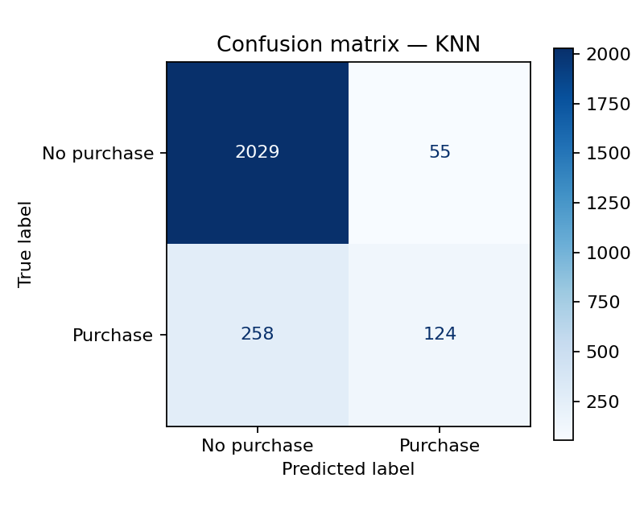
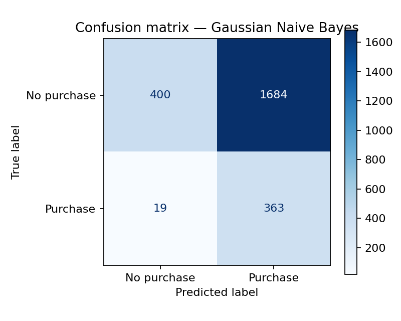

# E-Commerce Purchase Intention Prediction
### A reproducible comparative machine learning study

**Research question:** How reliably can a Decision Tree, K-Nearest Neighbors (KNN), and Gaussian Naive Bayes identify purchase-converting online shopping sessions, and how do their precision–recall trade-offs differ?

This research portfolio project adapts the coursework *Algorithm Evaluation Extravaganza* into a transparent, repeatable classification benchmark. **It does not claim original algorithmic novelty or causal identification.** Its contribution is methodological: a consistent evaluation of contrasting modeling assumptions on the same real-world e-commerce dataset.

## Results at a glance — verified Colab experiment

The following metrics were generated by executing the notebook on the UCI dataset and were checked against the exported confusion matrices. **These results are specific to this train/test split and model settings**, not a performance guarantee on other websites.

| Model | Accuracy | Precision | Recall | F1 | ROC-AUC | Average precision |
|---|---:|---:|---:|---:|---:|---:|
| **Decision Tree** | **0.899** | 0.711 | 0.586 | **0.643** | **0.917** | **0.686** |
| KNN | 0.873 | 0.693 | 0.325 | 0.442 | 0.816 | 0.525 |
| Gaussian Naive Bayes | 0.309 | 0.177 | **0.950** | 0.299 | 0.763 | 0.377 |
| Majority baseline | 0.845 | 0.000 | 0.000 | 0.000 | 0.500 | 0.155 |

**Training CV F1:** Decision Tree 0.627, KNN 0.470, Naive Bayes 0.309 (three-fold stratified). The tree's confusion matrix shows 224 true positives, 91 false positives, 158 false negatives, and 1,993 true negatives on **2,466 held-out sessions**.

**Critical sensitivity finding:** Removing `PageValues` from the Decision Tree reduces held-out F1 from **0.643 to 0.161** in an exploratory ablation. This raises a predictor-timing issue; it is not proof of leakage or a causal relationship. See the [results-based report](reports/research_report.md) and [PDF report](reports/research_report.pdf) for interpretation and limitations.

### Model performance visualizations

**ROC curves** compare class discrimination across decision thresholds. The Decision Tree recorded the highest ROC-AUC among these configured models.


**Precision–recall curves** emphasize performance on the less common purchase class.


### Confusion matrices

The Decision Tree correctly identified **224 purchasing sessions** and incorrectly identified **91 non-purchasing sessions** as purchases. It also missed **158 actual purchasing sessions**.


**K-Nearest Neighbors:** high overall accuracy, but low recall for purchasers.



**Gaussian Naive Bayes:** very high recall but many false-positive predictions.



### Exploratory data visualizations

**Purchase class distribution** — the data are imbalanced, so accuracy alone can be misleading.


**Engagement distribution** — examine the range and skew of browsing behavior.


### Downloadable evaluation results

- [Held-out model metrics (CSV)](results/test_model_metrics.csv)
- [Cross-validation scores and best hyperparameters (CSV)](results/cross_validation_summary.csv)
- [PageValues feature ablation (CSV)](results/pagevalues_ablation.csv)
- [Full research report (PDF)](reports/research_report.pdf)
- [Executed Google Colab notebook](notebooks/Algorithm_Evaluation_Extravaganza_UCI.ipynb)

**Audit note:** The [tracked notebook](notebooks/Algorithm_Evaluation_Extravaganza_UCI.ipynb) is the previously executed Colab version restored from GitHub history, with saved code outputs. The CSV and figures were supplied from the user's Colab export. Review the notebook, outputs, and report before final coursework submission.


## Dataset and attribution

- **Source:** Sakar, C., & Kastro, Y. (2018). *Online Shoppers Purchasing Intention Dataset*. UCI Machine Learning Repository. https://doi.org/10.24432/C5F88Q
- **Unit of observation:** An online shopping session, not necessarily a unique customer across time.
- **Size:** 12,330 sessions; 17 predictor fields plus `Revenue` (binary outcome).
- **Class distribution:** 1,908 sessions with purchases (15.5%), 10,422 without (84.5%).
- **Missingness:** The repository describes no missing data. The code checks this empirically before modeling.
- **Reuse terms:** Dataset licensed CC BY 4.0 by its creators; this repository cites the original source. Data is retrieved at run time, not committed to Git.

### Important prediction-time limitation

The recorded features are aggregated over a shopping session. Predicting a completed purchase using entire-session statistics does **not** establish that the model could make an early, real-time purchase prediction. `PageValues` is especially sensitive to timing and potential target-proximity concerns. We therefore evaluate an **ablation excluding `PageValues`** and explicitly discuss what data would be available at a real deployment decision point. High predictive performance is not proof of causal influence or profitability.

## Methods

1. Examine outcome balance, missingness, and extreme numerical values. Do not automatically delete genuine high-engagement sessions.
2. Create a single stratified 80/20 train/test partition (`random_state=42`). Do not touch the test partition during tuning.
3. Use a `ColumnTransformer` within each model `Pipeline`: numeric median imputation and standardization; categorical mode imputation and one-hot encoding. These transforms are fitted inside each training fold (no training/test leakage).
4. Tune **Decision Tree**, **KNN**, and **Gaussian Naive Bayes** using stratified cross-validation and F1 scoring. Compare with a majority-class baseline.
5. Score the locked models once on held-out test data: accuracy, balanced accuracy, precision, recall, F1, ROC-AUC, and average precision.
6. Export model-comparison tables, confusion matrices, ROC curves, and precision-recall curves. Conduct a `PageValues` sensitivity analysis.

**Why these three algorithms?** A Decision Tree produces interpretable splits and captures nonlinear interactions; KNN is a distance-based comparator sensitive to scaling; Gaussian Naive Bayes provides a simple probabilistic reference with restrictive distribution and independence assumptions.

## Quick start — Google Colab (recommended)

1. Visit https://colab.research.google.com/ and upload [`notebooks/Algorithm_Evaluation_Extravaganza_UCI.ipynb`](notebooks/Algorithm_Evaluation_Extravaganza_UCI.ipynb).
2. Choose **Runtime → Run all** (CPU runtime suffices). Colab must have internet access to retrieve the UCI dataset.
3. Review `cv_table` and `results_table` for **actual** scores; make sure all figures render.
4. Run the notebook's last cell to download `experiment_outputs.zip`.
5. The published repository includes validated CSVs in `results/`, figures in `results/figures/`, and a results-based draft report in [`reports/research_report.md`](reports/research_report.md). Review/edit these before submission.
6. Add your own contextual interpretation and ensure the report accurately reflects your executed Colab outputs. Commit only observed, correctly labeled results.

## Alternative — Run from terminal

```bash
python -m pip install -r requirements.txt
python -m src.run_experiment
```

This uses `ucimlrepo` to retrieve the UCI dataset online. If you already downloaded `online_shoppers_intention.csv`, use:

```bash
python -m src.run_experiment --csv /path/to/online_shoppers_intention.csv
```

Outputs will be saved to `results/` and `results/figures/`. No GPU required. To quickly validate the workflow on local data before a full analysis, specify `--fast` (reduced tuning grids; **not** a substitute for final reported results).

## Research quality and limitations

- **Imbalance:** A majority-class baseline reaches roughly 84.5% accuracy without identifying any purchaser; report F1 and PR-based metrics.
- **Uncertainty:** One holdout split does not describe sampling uncertainty; a future extension should repeat stratified CV and report interval estimates.
- **Feature timing:** Session summaries and `PageValues` may not be available early in a live session.
- **Transferability:** One site/period may not generalize to other businesses or changing shopping conditions.
- **Observational evidence:** Feature predictive importance is not a causal effect. Purchase prediction is not proof that targeting a user with an ad increases conversion.
- **Dataset ownership:** Original UCI dataset is CC BY 4.0. Repository code (if licensed) remains distinct from dataset rights.

## Repository layout

```text
notebooks/    Colab walkthrough and interactive outputs
src/          Reusable command-line modeling and evaluation pipeline
tests/        Synthetic-data smoke tests, not evidence of real-data performance
results/      Real-data outputs generated during execution
reports/      Results-based research report, PDF, and original template
.github/      Continuous integration of tests
```

## Citation

Cite the **dataset** using the UCI DOI above. For the code, see [`CITATION.cff`](CITATION.cff). If you use this for coursework, follow your institution's policy on the use of generative AI and publication of assignment solutions.

## References

Sakar, C., & Kastro, Y. (2018). *Online Shoppers Purchasing Intention Dataset* [Data set]. UCI Machine Learning Repository. https://doi.org/10.24432/C5F88Q

Sakar, C. O., Polat, S. O., Katircioglu, M., & Kastro, Y. (2019). Real-time prediction of online shoppers' purchasing intention using multilayer perceptron and LSTM recurrent neural networks. *Neural Computing and Applications, 31*, 6893–6908. https://doi.org/10.1007/s00521-018-3523-0

scikit-learn developers. (n.d.). *Common pitfalls and recommended practices*. https://scikit-learn.org/stable/common_pitfalls.html
