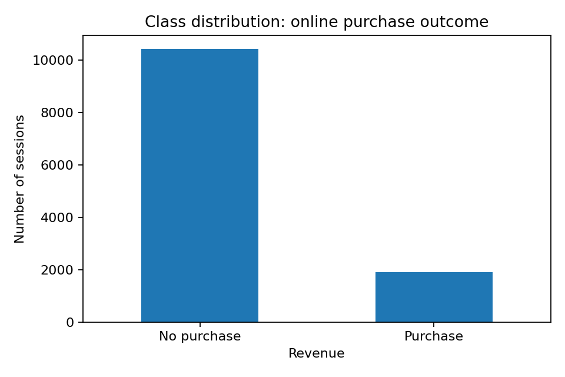
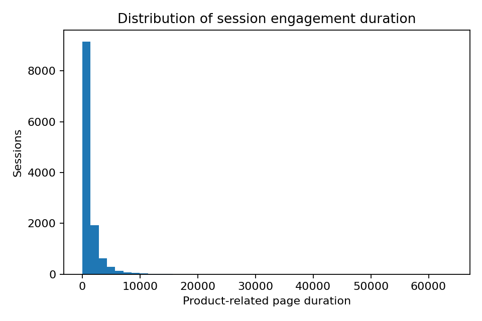
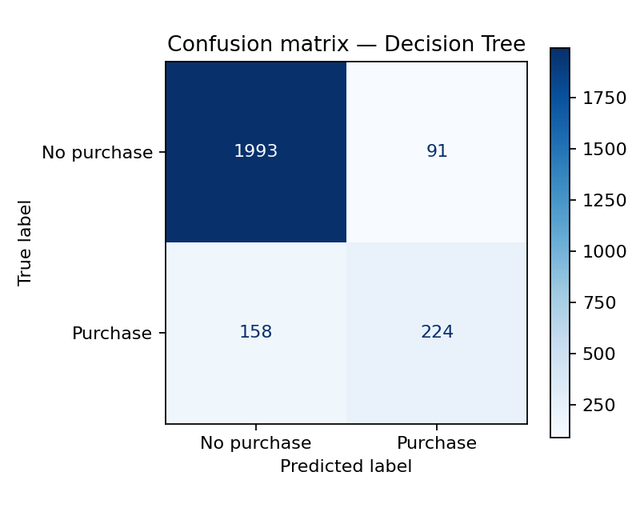
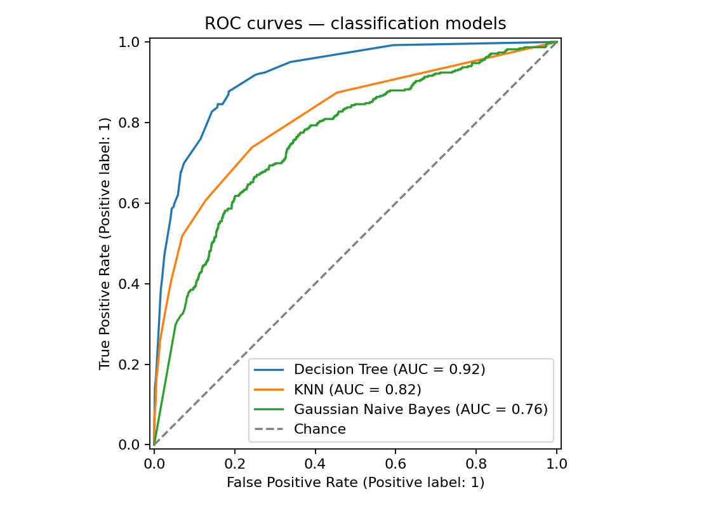
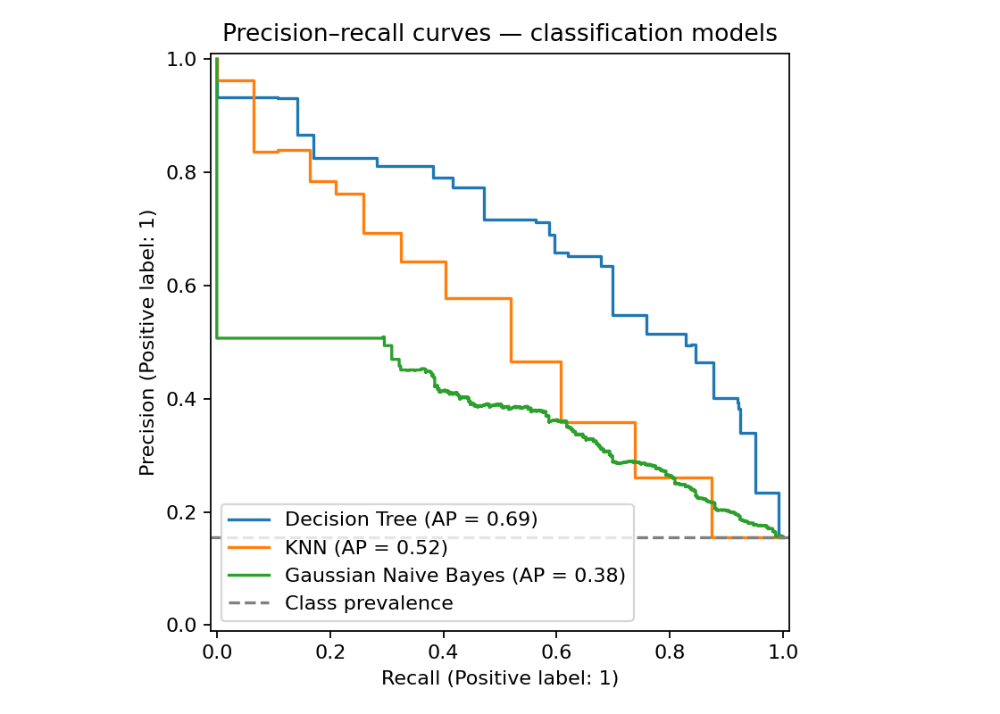

# E-Commerce Purchase Intention Prediction: A Comparative Machine Learning Study

**Researcher:** Muhammad Siddique  
**Date:** 9 October 2026  
**Dataset:** Online Shoppers Purchasing Intention Dataset (UCI, DOI: 10.24432/C5F88Q)  
**Status:** Published research project report based on the executed Colab experiment; accompanying [final PDF](research_report_final.pdf) is available for university submission.

## Abstract

This study evaluates three supervised classification algorithms for identifying e-commerce sessions associated with completed purchases. The UCI Online Shoppers Purchasing Intention Dataset contains 12,330 sessions, 17 predictors, and a binary purchase indicator (`Revenue`). Decision Tree, K-Nearest Neighbors (KNN), and Gaussian Naive Bayes were evaluated against a majority-class baseline. Models were tuned using three-fold stratified cross-validation on 80% of the observations and evaluated on a held-out 20% test set. The Decision Tree achieved the highest held-out F1-score (0.643), with 89.90% accuracy, 71.11% precision, and 58.64% recall. KNN achieved an F1-score of 0.442, while Gaussian Naive Bayes achieved an F1-score of 0.299 despite very high recall (95.03%). The majority baseline achieved 84.51% accuracy but zero recall. An exploratory feature-ablation test showed that removing `PageValues` reduced the Decision Tree's F1-score from 0.643 to 0.161, raising an important question about predictor availability at the intended decision point. The results support the Decision Tree as the strongest of these configured models for balanced precision and recall, but do not establish deployment readiness, intervention effects, or generalizability beyond the study dataset.

## 1. Introduction and research question

Online retailers continuously collect session-level information about browsing activity, referral channels, and interactions with product pages. Such data may help distinguish visits ending in purchases from visits without transactions. Predictive models can support descriptive marketing analytics, but an apparently accurate model may still fail to detect the comparatively rare purchase class. This study therefore asks: **Which of three conventional classifiers identifies purchase-ending sessions most effectively under a common, leakage-aware experimental protocol?**

The objective is to compare predictive performance rather than establish why individuals purchase. A predictive association between a browsing feature and a completed transaction does not imply that changing the feature would cause a purchase.

## 2. Dataset and exploratory analysis

The dataset was obtained from the UCI Machine Learning Repository (Sakar & Kastro, 2018). It includes **12,330 sessions**, **17 predictor variables**, and the binary outcome `Revenue`. In the full dataset, **1,908 sessions (15.47%)** ended in a purchase, while **10,422 (84.53%)** did not. The held-out test sample comprises 2,466 sessions: **382 purchases** and **2,084 non-purchases**.

Predictors include measures of website engagement, visit characteristics, and categorical identifiers. The source describes no missing observations, and the executed notebook independently confirms zero missing values across predictor fields. Median and mode imputers were consequently built as safeguards for potential future records, not as evidence that missing observations were repaired in this dataset. The exploratory notebook also plots the distribution of product-page browsing duration. Long browsing sessions or unusually large `PageValues` may be legitimate observations and should not be deleted without contextual validation.

The outcome balance and engagement-duration distributions are shown in Appendix A (Figures 1-2).

## 3. Preprocessing and analytical methodology

Data were split into **80% training (9,864 sessions)** and **20% testing (2,466 sessions)** using stratification and `random_state=42`. `Month`, `OperatingSystems`, `Browser`, `Region`, `TrafficType`, `VisitorType`, and `Weekend` were treated as categorical. Their values were imputed with the most frequent category when necessary and one-hot encoded. Numerical predictors were assigned median imputation as a safeguard and standardized. Transformations were implemented through scikit-learn pipelines and fitted using training data within each cross-validation fold, thereby preventing the held-out test data from informing fitted preprocessing parameters.

Three algorithms represented distinct modeling assumptions. The **Decision Tree** captures nonlinear splits and remains comparatively interpretable, but requires depth and leaf-size constraints to avoid overfitting. **KNN** classifies sessions based on local distances, making scaling important and potentially suffering from high-dimensional sparse encoding. **Gaussian Naive Bayes** is a fast probabilistic benchmark, although independence and Gaussian-distribution assumptions can be implausible for one-hot encoded categories and skewed engagement variables.

A three-fold stratified cross-validation grid search optimized **F1-score** on the training data. The majority-class dummy classifier supplied an accuracy benchmark. Test-set evaluation included accuracy, balanced accuracy, precision, recall, F1-score, ROC-AUC, and average precision. All reported results below come from the supplied Colab output files, not synthetic test data.

### 3.1 Best training cross-validation settings

| Model | Best mean CV F1 | Selected hyperparameters |
|---|---:|---|
| Decision Tree | 0.627 | `max_depth=5`, `min_samples_leaf=10` |
| KNN | 0.470 | `n_neighbors=11` |
| Gaussian Naive Bayes | 0.309 | `var_smoothing=1e-7` |

## 4. Experimental results

### 4.1 Held-out test performance

| Model | Accuracy | Balanced accuracy | Precision | Recall | F1 | ROC-AUC | Average precision |
|---|---:|---:|---:|---:|---:|---:|---:|
| Decision Tree | 0.899 | 0.771 | 0.711 | 0.586 | **0.643** | 0.917 | 0.686 |
| KNN | 0.873 | 0.649 | 0.693 | 0.325 | 0.442 | 0.816 | 0.525 |
| Gaussian Naive Bayes | 0.309 | 0.571 | 0.177 | **0.950** | 0.299 | 0.763 | 0.377 |
| Majority-class baseline | 0.845 | 0.500 | 0.000 | 0.000 | 0.000 | 0.500 | 0.155 |

The Decision Tree achieved the strongest F1-score and ranking performance among the evaluated models. Its **89.90% accuracy** surpassed the majority-class baseline's **84.51%**, but the more substantive distinction is that the tree successfully classified many purchasing sessions rather than simply predicting the dominant non-purchase class. The Decision Tree's held-out F1-score (0.643) was close to its selected training-CV F1-score (0.627), though a single split does not establish stable out-of-sample performance.

KNN produced comparatively high precision (0.693) but low recall (0.325), indicating that it identified fewer actual purchasers. Gaussian Naive Bayes showed the opposite pattern: recall reached 0.950, but precision fell to 0.177 and overall accuracy to 0.309. This suggests that under the default decision rule, the model flagged a large share of non-purchasing sessions as purchases. Its high recall should not be treated as evidence of overall superiority.

### 4.2 Error analysis

| Classifier | True negatives | False positives | False negatives | True positives |
|---|---:|---:|---:|---:|
| Decision Tree | 1,993 | 91 | 158 | 224 |
| KNN | 2,029 | 55 | 258 | 124 |
| Gaussian Naive Bayes | 400 | 1,684 | 19 | 363 |

For the Decision Tree, **224 of 382 purchasing sessions** were detected, while **158 purchasers were missed**. Among non-purchasing sessions, **91 were incorrectly labeled as purchases**. This operating point favors a reasonable balance of precision and recall. Whether it is economically preferable depends on the cost of contacting non-purchasers and the value of correctly identifying likely purchasers; neither is measured by this dataset.

The complete Decision Tree confusion matrix and cross-model discrimination curves are presented in Appendix A (Figures 3-5).

## 5. Sensitivity analysis: excluding PageValues

The exploratory ablation selected the Decision Tree using the **training cross-validation ranking** and refitted it without `PageValues` using the previously selected hyperparameters.

| Model specification | Held-out F1 |
|---|---:|
| Decision Tree with all predictors | 0.643 |
| Decision Tree without `PageValues` | 0.161 |

The absolute difference was **0.482 F1 points**. This demonstrates strong sensitivity to this feature under the tested model specification, but **it does not establish that `PageValues` causes purchasing behavior or that data leakage occurred**. Because some inputs summarize a complete session, their availability at the time a real-time decision would be made remains uncertain. A deployable early-session model would need to define a prediction timestamp, use only information available before that timestamp, and repeat model selection and validation using the eligible inputs. This exploratory test-set analysis should not be used as a new, independent confirmatory test.

## 6. Limitations and lessons learned

First, the data originate from one dataset and a finite collection period; performance may change across websites, customer populations, or seasons. Second, the random stratified split is not a temporal or site-level external validation and may be optimistic if observations from related sessions or shared time periods appear in both subsets. Third, the current feature set includes session summaries whose prediction-time availability needs scrutiny. Fourth, Gaussian Naive Bayes assumptions are particularly restrictive for this mix of skewed and encoded features. Fifth, one holdout split gives point estimates rather than uncertainty intervals.

The analysis highlights the importance of **metric selection**: the majority classifier produces apparently respectable accuracy while failing entirely on the class that motivates the task. It also shows why a model with exceptionally high recall can still perform poorly when precision is low. A practical next investigation would define the decision timing, remove unavailable variables before any model selection, repeat stratified or time-aware validation as appropriate, and assess probability calibration and threshold-specific decision costs. None of these experiments can, without intervention data, establish the incremental sales effect of an advertisement or discount.

## 7. Conclusion

Under the prespecified comparison, the tuned Decision Tree provided the most favorable precision-recall balance, attaining an F1-score of **0.643** and ROC-AUC of **0.917** on the held-out set. KNN was more conservative in assigning purchases and missed more positive sessions, while Gaussian Naive Bayes prioritized sensitivity at the expense of many false alarms. The feature-ablation result demonstrates that apparent predictive success can rely heavily on predictors whose operational availability has not yet been verified. The project therefore provides a reproducible benchmark and a basis for further methodological work, **not** evidence that the selected model is ready for live deployment or that using it will increase revenue.

## References (APA 7th edition)

Sakar, C., & Kastro, Y. (2018). *Online Shoppers Purchasing Intention Dataset* [Data set]. UCI Machine Learning Repository. https://doi.org/10.24432/C5F88Q

Sakar, C. O., Polat, S. O., Katircioglu, M., & Kastro, Y. (2019). Real-time prediction of online shoppers' purchasing intention using multilayer perceptron and LSTM recurrent neural networks. *Neural Computing and Applications, 31*(10), 6893-6908. https://doi.org/10.1007/s00521-018-3523-0

scikit-learn developers. (n.d.). *Common pitfalls and recommended practices*. https://scikit-learn.org/stable/common_pitfalls.html

---

**Submission integrity note:** Review the interpretations and saved notebook outputs before submitting to the university portal. Follow institutional publication, authorship, and AI-assistance policies.

## Appendix A. Figures

